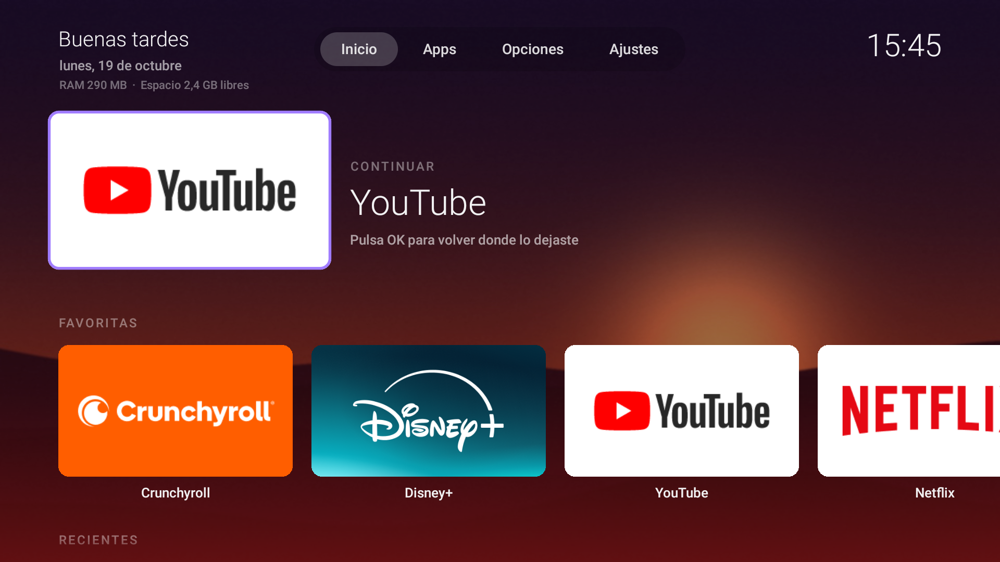
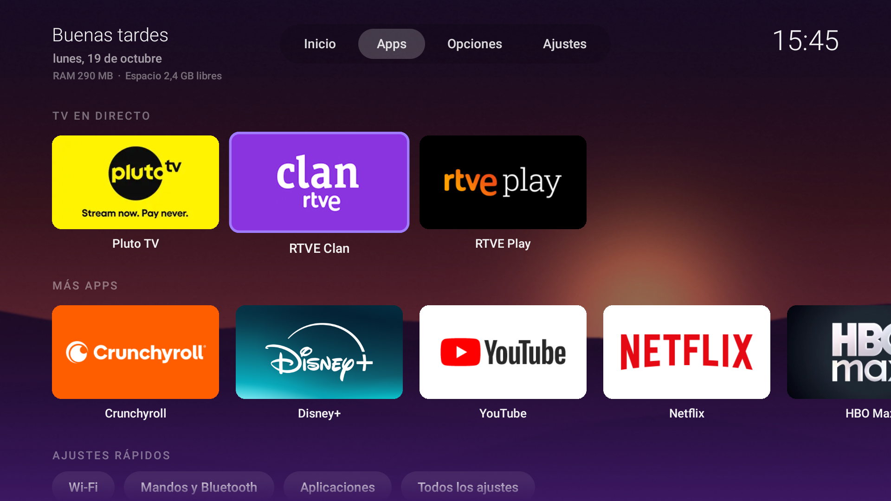

# FreeTV

A home screen for Amazon Fire TV with no ads, no tracking and no internet permission.
Your apps, what you were watching, and nothing else.

FreeTV is a fork of **dumbtv home**, the launcher in [humblemuzzu/dumbtv](https://github.com/humblemuzzu/dumbtv)
by [@DevMuzzammil](https://x.com/DevMuzzammil). The hard part, taking over the HOME button on Fire OS without root,
is his work; FreeTV builds a richer home screen on top of it. If you want the debloat scripts and the
DNS filter, use dumbtv: FreeTV is only the launcher.



## What it adds

- **Continue**: the last app you opened, large, at the top. Press OK to jump back in.
- **Favorites** with larger tiles, and **Recent** apps.
- **Tabs**: Home shows what you watch; Apps holds everything else, your categories, HDMI inputs and quick settings.
- **Categories**: group apps into rows (tile menu → Category…).
- **Ambient color**: a soft glow in the focused app's color.
- **Wallpapers**: several images that rotate on every return home, hourly, daily or by time of day
  (name files with `morning`, `afternoon` or `night`).
- **Header**: greeting, free memory and storage, clock, and **Now playing** with pause and next.
- **Quick settings**: Wi-Fi, remotes and Bluetooth, apps, all settings.
- **Animations** tuned for a Fire TV Stick: rows scroll whole, the focused tile stays centered.
- Home screen text in Spanish or English, following the TV's language (Options is in English).

Everything can be turned off in **Options**. The APK is about 50 KB, plain Java with no libraries,
and requests **no permissions**.



## Install

You need a computer on the same network as the TV, [Android platform-tools](https://developer.android.com/tools/releases/platform-tools)
(`adb`), a JDK 17+ and the Android SDK build-tools (FreeTV is built from source on your machine and signed with your own key).

1. On the TV: Settings → My Fire TV → About, press the device name 7 times. Then in Developer options
   turn on **ADB debugging**, and note the IP address from About → Network.
2. Run the installer, then accept the "Allow USB debugging" prompt on the TV the first time:

   **Windows (PowerShell)**
   ```powershell
   .\install.ps1 -Tv 192.168.1.50
   ```

   **macOS / Linux**
   ```sh
   adb connect 192.168.1.50:5555
   ./install.sh
   ```

The installer builds the APK, installs it, and gives it the HOME button. Coming from dumbtv home, it copies
your settings and wallpapers over.

**Undo**: `.\install.ps1 -Tv <ip> -Undo` or `./install.sh --undo` hands HOME back to Amazon's launcher;
`adb uninstall tv.freetv.home` removes FreeTV.

## How HOME works on Fire OS

Fire OS keeps HOME bound to Amazon's protected launcher. As in dumbtv, a small accessibility service (`Guard`)
watches for Amazon's home window and replaces it with FreeTV through an alarm, so Android's five-second
app-switch delay does not apply (`alarm_manager_constants min_futurity=0`). It reads no screen content.
Hold HOME for the Fire OS quick menu; Options → "Open Amazon's home screen" still works.

## Limits worth knowing

- **Recent and Continue only see apps opened from FreeTV.** Fire OS does not report other apps' windows to
  accessibility services, so an app opened by voice does not show up there.
- **Now playing** needs a notification listener, which the installer enables over ADB. It only reads the
  active media session, never your notifications.
- Some Fire OS settings screens (Display & Sounds, Device info, Accessibility) only open from Amazon's own
  launcher, so they are not in quick settings.
- After updating FreeTV, the first HOME press can still show Amazon's home while the service rebinds;
  run the installer again if it persists.

## Settings file

Everything lives in `/sdcard/Android/data/tv.freetv.home/files/home.conf` (edit it on the TV in Options, or by
hand). Wallpapers go in the `wallpapers/` folder next to it.

```sh
adb shell mkdir -p /sdcard/Android/data/tv.freetv.home/files/wallpapers
adb push morning-sky.jpg night-stars.jpg /sdcard/Android/data/tv.freetv.home/files/wallpapers/
```

## En español

FreeTV es una pantalla de inicio para Fire TV sin anuncios ni rastreo, basada en el launcher de
[dumbtv](https://github.com/humblemuzzu/dumbtv). Añade "Continuar", favoritas, pestañas, categorías, fondos que
cambian según la hora, color ambiental y "Sonando ahora". Para instalarlo desde Windows:
`.\install.ps1 -Tv <ip-de-la-tele>`.

## License

MIT, as dumbtv. See [LICENSE](LICENSE).
