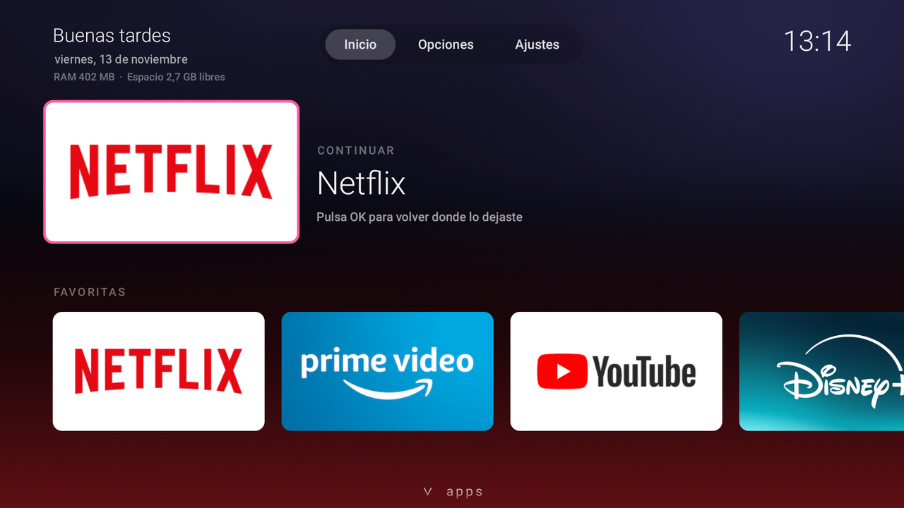
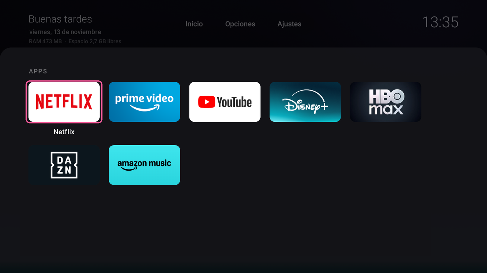

# FreeTV

A home screen for Amazon Fire TV, where third-party launchers cannot normally take over the
HOME button. No root, no ads, no tracking and no internet permission.
Your apps, what you were watching, and nothing else.

FreeTV is a fork of **dumbtv home**, the launcher in [humblemuzzu/dumbtv](https://github.com/humblemuzzu/dumbtv)
by [@DevMuzzammil](https://x.com/DevMuzzammil). The hard part, taking over the HOME button on Fire OS without root,
is his work; FreeTV builds a richer home screen on top of it. If you want the debloat scripts and the
DNS filter, use dumbtv: FreeTV is only the launcher.



## What it adds

- **Continue**: the last app you opened, large, at the top. Press OK to jump back in.
- **Favorites** with larger tiles, and **Recent** apps.
- **Tabs**: Home shows what you watch; Apps holds everything else, your categories, HDMI inputs and quick settings.
- **Categories**: group apps into rows (tile menu → Category…).
- **Ambient color**: a soft glow in the focused app's color.
- **Wallpapers**: six are bundled and unpacked on the first run, two for each time of day, and
  rotate on every return home, hourly, daily or by time of day (the rotation reads `morning`,
  `afternoon` and `night` in the file name). They are generated by `tools/gen_wallpapers.py`, so
  there is no third-party artwork in here.
- **Favorites on the first run**: Netflix, Prime Video, YouTube, Disney+, HBO Max, DAZN and Amazon
  Music are favorited if they are installed, in that order. Long press any tile to change it; empty
  the row and it stays empty.
- **Header**: greeting, free memory and storage, clock, and **Now playing** with pause and next.
- **Quick settings**: Wi-Fi, remotes and Bluetooth, apps, all settings.
- **Animations** tuned for a Fire TV Stick: rows scroll whole, the focused tile stays centered.
- Home screen text in Spanish or English, following the TV's language (Options is in English).

Everything can be turned off in **Options**. The APK is about 50 KB, plain Java with no libraries,
and requests **no permissions**.



## Install

All you need is a computer on the same network as the TV and
[Android platform-tools](https://developer.android.com/tools/releases/platform-tools) (`adb`).
The installer downloads the published APK and checks its SHA-256 against `version.env` before
installing anything.

1. On the TV: Settings → My Fire TV → About, press the device name 7 times. Then in Developer options
   turn on **ADB debugging**, and note the IP address from About → Network.
2. Run the installer, then accept the "Allow USB debugging" prompt on the TV the first time:

   **Windows (PowerShell)**
   ```powershell
   .\install.ps1 -Tv 192.168.1.50
   ```

   **macOS / Linux**
   ```sh
   adb connect 192.168.1.50:5555
   ./install.sh
   ```

The installer installs the APK and gives it the HOME button. Coming from dumbtv home, it copies
your settings and wallpapers over.

### Let an AI agent do it

If you have a coding assistant with shell access (Claude Code, Codex, Gemini CLI), paste
[PROMPT.md](PROMPT.md) into it instead. It checks your setup, finds the TV, confirms what it is about
to do, and runs the same installer.

### Build it yourself

If you would rather not trust a prebuilt APK, build and sign it with your own key. This needs a
JDK 17+ and the Android SDK build-tools on top of `adb`:

```powershell
.\install.ps1 -Tv 192.168.1.50 -Build   # Windows
```

```sh
./install.sh --build                    # macOS / Linux
```

Both paths produce the same app. They are signed with different keys, so switching between them means
uninstalling first (`adb uninstall tv.freetv.home`); back up
`/sdcard/Android/data/tv.freetv.home/files/home.conf` if you want to keep your settings.

**Undo**: `.\install.ps1 -Tv <ip> -Undo` or `./install.sh --undo` hands HOME back to Amazon's launcher;
`adb uninstall tv.freetv.home` removes FreeTV.

## How HOME works on Fire OS

Fire OS keeps HOME bound to Amazon's protected launcher. As in dumbtv, a small accessibility service (`Guard`)
watches for Amazon's home window and replaces it with FreeTV through an alarm, so Android's five-second
app-switch delay does not apply (`alarm_manager_constants min_futurity=0`). It reads no screen content.
Hold HOME for the Fire OS quick menu; Options → "Open Amazon's home screen" still works.

## Limits worth knowing

- **Recent and Continue only see apps opened from FreeTV.** Fire OS does not report other apps' windows to
  accessibility services, so an app opened by voice does not show up there.
- **Now playing** needs a notification listener, which the installer enables over ADB. It only reads the
  active media session, never your notifications.
- Some Fire OS settings screens (Display & Sounds, Device info, Accessibility) only open from Amazon's own
  launcher, so they are not in quick settings.
- After updating FreeTV, the first HOME press can still show Amazon's home while the service rebinds;
  run the installer again if it persists.

## Settings file

Everything lives in `/sdcard/Android/data/tv.freetv.home/files/home.conf`. Edit it on the TV in
**Options**, which is the only way that works on every Fire OS version.

Editing it over ADB is not one of them any more. From Android 11 (Fire OS 8) scoped storage stops
the shell writing into another app's folder under `/sdcard/Android/data/`, so `adb push` there fails
with `Permission denied`. The same goes for dropping in your own wallpapers: there is no way to do
it from a computer without giving FreeTV a storage permission, and it requests **none**. Six
wallpapers ship with the app instead, and Options rotates through them.

```sh
# this no longer works on Fire OS 8 and later
adb push my-photo.jpg /sdcard/Android/data/tv.freetv.home/files/wallpapers/
# Permission denied
```

## En español

FreeTV es una pantalla de inicio para Fire TV sin anuncios ni rastreo, basada en el launcher de
[dumbtv](https://github.com/humblemuzzu/dumbtv). Añade "Continuar", favoritas, pestañas, categorías, fondos que
cambian según la hora, color ambiental y "Sonando ahora". Trae seis fondos incluidos y marca como
favoritas las apps de streaming que ya tengas instaladas. Solo hace falta `adb` y un ordenador en la misma red: el instalador descarga el APK publicado y
comprueba su SHA-256 antes de instalar nada. Desde Windows:
`.\install.ps1 -Tv <ip-de-la-tele>`. Si prefieres compilarlo tú, añade `-Build`.

## License

MIT, as dumbtv. See [LICENSE](LICENSE).
